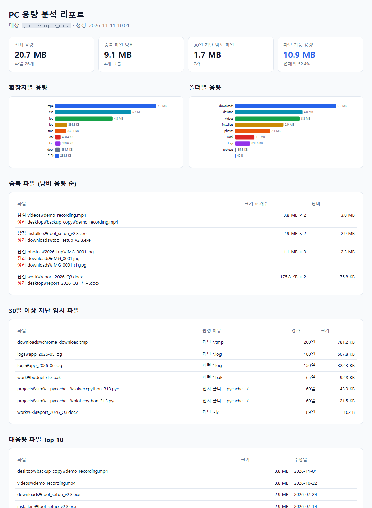
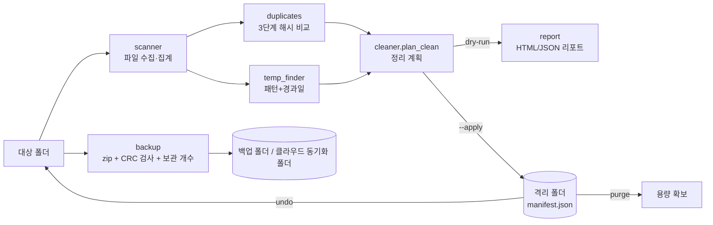

# PC Cleaner: PC 용량 확보 및 백업 자동화 도구

하드디스크 공간을 차지하는 **중복 파일**과 **오래된 임시 파일**을 찾아 안전하게 정리하고,
중요 작업 폴더를 **날짜별 zip으로 자동 백업**하는 Python CLI 도구입니다.
LLM 코딩 에이전트(Claude Code)를 활용해 개발했습니다.

- 핵심 기능은 **Python 표준 라이브러리만** 사용합니다(설치할 것이 거의 없음).
- 정리는 기본이 **미리보기(dry-run)**이고, 실행해도 바로 삭제하지 않고 **격리 폴더로 이동**합니다. `undo`로 복구할 수 있습니다.
- 결과를 **그래프가 포함된 HTML 리포트**로 저장합니다.



📑 **발표 자료:** [docs/presentation.pptx](docs/presentation.pptx) (9장, 발표자 노트 포함. 생성 스크립트: [docs/slides/build_pptx.py](docs/slides/build_pptx.py))

---

## 1. 주요 기능

| 기능 | 명령 | 설명 |
|---|---|---|
| 용량 분석 | `scan` | 확장자별·폴더별 용량, 대용량 파일 Top N, HTML/JSON 리포트 |
| 중복 탐지 | `scan`, `clean` | 크기 → 앞부분 64KB 해시 → 전체 SHA-256 순서로 빠르게 확정. 가장 오래된 파일을 원본으로 남김 |
| 임시 파일 탐지 | `scan`, `clean` | `*.tmp`, `*.log`, `*.bak`, `~$*`, `__pycache__/` 등 N일(기본 30) 이상 지난 파일 |
| 안전한 정리 | `clean --apply` | 격리 폴더로 이동하고 manifest.json에 기록. 실행 직전 파일 변경 여부를 다시 확인 |
| 되돌리기 | `undo` | 가장 최근(또는 지정한) 정리를 원위치로 복구. 같은 이름의 파일이 있으면 덮어쓰지 않음 |
| 영구 삭제 | `purge` | 격리 세션을 비워 실제 용량 확보 (`--yes` 필요) |
| 백업 | `backup` | `폴더명_YYYY-MM-DD_HHMMSS.zip` 생성, CRC 검사, 최근 N개만 보관 |
| 자동 예약 | `schedule` | Windows 작업 스케줄러(`schtasks`)와 crontab 등록 명령 출력 |

> **클라우드 백업:** `--dest`를 OneDrive, Google Drive, Dropbox의 동기화 폴더로 지정하면
> API 인증 없이 클라우드에 자동 업로드됩니다.

## 2. 시스템 구조



```
school_project/
├── main.py                  실행 진입점
├── pccleaner/
│   ├── scanner.py           폴더 순회, 용량 집계
│   ├── duplicates.py        중복 파일 탐지
│   ├── temp_finder.py       오래된 임시 파일 탐지
│   ├── cleaner.py           정리 계획 / 격리 이동 / undo / purge
│   ├── backup.py            zip 백업, 보관 개수 관리
│   ├── report.py            HTML(SVG 그래프) / JSON 리포트
│   └── cli.py               명령행 인터페이스
├── tools/make_sample_data.py  샘플 데이터 생성기
├── tests/test_pccleaner.py    pytest 테스트 13개
├── docs/prompt_log.md         LLM 활용 및 디버깅 기록
├── docs/presentation.pptx     발표 자료 (생성: docs/slides/build_pptx.py)
└── .github/workflows/ci.yml   GitHub Actions (lint + test)
```

## 3. 실행 환경 설정

- Python **3.10 이상** (Windows 11 / Python 3.13에서 개발·검증)

```bash
git clone <이 저장소 URL>
cd school_project
python -m venv .venv
```

Windows:
```bash
.venv\Scripts\activate
```
macOS/Linux:
```bash
source .venv/bin/activate
```
```bash
pip install -r requirements.txt
```

> Windows에서 `python`을 입력하면 Microsoft Store가 열리면 `py -m venv .venv`를 사용하세요.

## 4. 기능 테스트 실행 (pytest 13개)

환경 설정을 마쳤다면 가상환경이 활성화된 상태에서 아래 명령을 실행합니다.

```bash
python -m pytest -v
```

환경설정 점검용이 아니라 **PC Cleaner의 각 기능이 올바르게 동작하는지 자동으로 확인하는 테스트**입니다.
각 테스트는 임시 폴더(`tmp_path`)에서만 실행되므로 실제 PC 파일은 건드리지 않습니다.
13개가 모두 `passed`이면 설치가 정상이라는 것도 함께 확인되므로, 다음 단계인 샘플 실습으로 넘어가면 됩니다.

| 확인하는 기능 | 테스트 예시 |
|---|---|
| 용량 표시 | `test_human_size`: 바이트를 KB/MB 등 읽기 쉬운 단위로 바꿔 주는지 |
| 스캔 | `test_scan_excludes_default_dirs`: 제외해야 할 기본 폴더를 건너뛰는지 |
| 중복 파일 찾기 | `test_duplicates_keep_oldest_and_ignore_same_size_different_content`: 가장 오래된 파일을 남기고, 크기만 같고 내용이 다른 파일은 중복으로 잡지 않는지 |
| 임시 파일 찾기 | `test_temp_files_by_age_and_pattern`, `test_temp_dir_check_uses_relative_path`: 오래된 파일과 패턴에 맞는 파일을 골라내는지 |
| 정리와 되돌리기 | `test_clean_undo_roundtrip`, `test_clean_skips_changed_file_and_missing_original`, `test_undo_does_not_overwrite`: `clean` 후 `undo`로 복구되는지, 기존 파일을 덮어쓰지 않는지 |
| 휴지통 비우기 | `test_purge_frees_space`: `purge`로 실제 공간이 확보되는지 |
| 백업 | `test_backup_retention_and_integrity`, `test_backup_dest_inside_source`: 보관 개수와 무결성을 지키는지, 백업 위치가 원본 안이면 막는지 |
| CLI 전체 흐름 | `test_cli_end_to_end`: `main.py` 명령이 처음부터 끝까지 동작하는지 |
| 샘플 생성기 | `test_sample_generator_refuses_non_sample_folder`: 샘플 폴더가 아닌 곳에는 파일을 만들지 않는지 |

> 가상환경을 활성화하지 않았다면 `.venv\Scripts\python.exe -m pytest -v`(Windows)로 실행하세요.

## 5. 바로 테스트해 보기 (샘플 데이터)

```bash
python tools/make_sample_data.py
```
`sample_data/` 폴더에 중복 파일, 대용량 파일, 60~200일 지난 임시 파일 등 26개 파일(20.7 MB)이 생성됩니다.

**① 분석 + 리포트**
```bash
python main.py scan sample_data --report output/report.html --json output/report.json
```

**② 정리 미리보기 (아무것도 바뀌지 않음)**
```bash
python main.py clean sample_data
```

**③ 정리 실행 → 확인 → 되돌리기**
```bash
python main.py clean sample_data --apply
```
```bash
python main.py sessions
```
```bash
python main.py undo
```

**④ 실제 용량 확보 (격리 폴더 영구 삭제)**
```bash
python main.py purge --older-than 0
```
목록을 확인한 뒤 `--yes`를 붙여 실행합니다.

**⑤ 백업 (최근 3개만 보관)**
```bash
python main.py backup sample_data/work --dest output/backups --keep 3
```

**⑥ 매일 09:00 자동 백업 등록 명령 출력**
```bash
python main.py schedule --source sample_data/work --dest output/backups --time 09:00
```

### 실행 결과 예시

```
[스캔] ...\sample_data  파일 26개, 20.7 MB

[중복 파일] 4개 그룹, 낭비 9.1 MB
  남김  videos\demo_recording.mp4  (3.8 MB)
   └ 정리 desktop\backup_copy\demo_recording.mp4
  남김  photos\2026_trip\IMG_0001.jpg  (1.1 MB)
   └ 정리 downloads\IMG_0001.jpg
   └ 정리 downloads\IMG_0001 (1).jpg
  ...
[오래된 임시 파일] 7개, 1.7 MB
  downloads\chrome_download.tmp  (781.2 KB, 패턴 *.tmp, 200일)
  ...
[확보 가능 용량] 10.9 MB (파일 12개)
```

## 6. 주요 옵션

| 옵션 | 기본값 | 설명 |
|---|---|---|
| `--age-days N` | 30 | 임시 파일로 판정할 경과 일수 |
| `--min-size BYTES` | 1 | 중복 검사 최소 크기 (작은 파일 무시) |
| `--no-duplicates` / `--no-temp` | - | 해당 유형은 정리하지 않음 |
| `--workdir DIR` | `./.pccleaner` | 격리 폴더와 기록 위치 (명령 앞에 지정) |
| `--keep N` | 7 | 보관할 최근 백업 개수 |
| `--display-root TEXT` | 홈 폴더를 `~`로 가림 | `scan` 리포트에 표시할 대상 경로 (공유용 캡처에서 사용자 이름 숨김) |

`.git`, `.venv`, `node_modules`, `$RECYCLE.BIN` 등은 자동으로 스캔에서 제외되고, 심볼릭 링크는 따라가지 않습니다.

## 7. 개발 과정: LLM 활용 요약

**Claude Code**(Claude Opus 5.5)를 개발 도구로 사용했습니다. 완성된 프로그램은 LLM 없이 동작합니다.
전체 기록은 [docs/prompt_log.md](docs/prompt_log.md)에 있습니다.

### 핵심 프롬프트

| # | 프롬프트 | 결과 |
|---|---|---|
| 1 | `"PC 정리 백업"에 대한 프로젝트 분석` | 과제 요건 정리, 위험 요소(실수 삭제)와 재현성(샘플 데이터) 대책, LLM은 개발 도구로 쓰고 결과물은 순수 Python으로 만든다는 방향 결정 |
| 2 | `개발하면서 prompt_log.md로 저장하면서 개발 진행` | 설계, 구현, 디버깅, 테스트 13개, GitHub Actions, README, 개발 기록 |
| 3 | `발표자료 수정 가능하게 ppt로 작성` | 편집 가능한 9장 PPTX(발표자 노트 포함)와 생성 스크립트 |

### 문제 해결 과정 요약

| 문제 | 해결 |
|---|---|
| `python` 명령이 Store 바로가기라 실행 안 됨 | `py` 런처로 가상환경 생성 |
| 절대 경로에 `Temp`가 있으면 모든 파일이 임시 파일로 판정 | 스캔 루트 기준 상대 경로로 검사, 테스트 추가 |
| 샘플 생성기가 `--out` 폴더를 통째로 삭제할 위험 | 표식 파일이 있는 폴더만 재생성 |
| Git이 수정 날짜를 보존하지 않아 샘플의 '오래된 파일'이 사라짐 | 생성 스크립트로 날짜 지정 |
| 같은 드라이브 내 격리 이동은 용량이 늘지 않음 | `purge` 명령 추가 |
| 백업 폴더가 원본 안에 있으면 자기 자신을 압축 | 대상 폴더 제외, `.partial` 후 CRC 검사 |
| 스캔 후 파일이 바뀌거나 중복 원본이 사라지는 경우 | 실행 직전 재확인, undo는 덮어쓰지 않음 |
| 공개 리포트 캡처에 PC 사용자 이름 노출 | `--display-root` 옵션, 기본은 홈 폴더를 `~`로 가림 |

## 8. 주의 사항

- 처음에는 반드시 샘플 데이터나 중요하지 않은 폴더로 시험하세요.
- `purge`는 복구할 수 없습니다. 격리 상태로 며칠 사용해 본 뒤 `purge --older-than 14 --yes`처럼 쓰는 것을 권장합니다.
- 시스템 폴더(`C:\Windows`, `Program Files`)는 정리 대상으로 지정하지 마세요.
